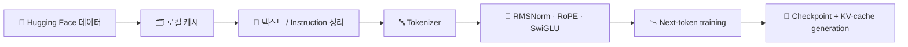

<div align="center">

# 🇰🇷 Korean LLM · v1

### 한국어 LLM을 직접 만드는 첫 번째 실험실


**데이터를 내려받고 · Transformer를 만들고 · 직접 학습시키는 시작점**

</div>

> v1은 `seoan1024`의 한국어 LLM 연구 계열에서 가장 단순하고 중요한 기준선입니다. 이후 버전의 모든 변화는 이 학습 루프에서 출발합니다.

## 🧭 한눈에 보는 v1



| 항목 | v1 구현 |
|---|---|
| 모델 | Decoder-only Transformer |
| 핵심 블록 | RMSNorm · RoPE · SwiGLU · Causal Attention |
| 기본 구조 | `dim=1280` · `20 layers` · `10 heads` |
| 기본 학습 길이 | `256 tokens` |
| 데이터 | `maywell/korean_textbooks` · `beomi/KoAlpaca-v1.1a` |
| 저장 | `datasets/cache/` · `checkpoints/*.pth` |

## ✨ v1에서 해결한 초기 문제

- EOS를 문자열로 덧붙이는 대신 `eos_token_id`를 토큰화 결과에 명시적으로 추가
- 고정 길이 샘플의 남은 부분을 PAD 토큰으로 채우도록 정리
- 토큰화 실패 시 학습 루프가 즉시 깨지지 않도록 PAD-only fallback 제공
- 데이터셋을 매번 다시 받지 않도록 hash manifest 기반 캐시 도입
- 다운로드 실패 시 standard → streaming → force-redownload 순서로 재시도
- 학습 중단 후 model / optimizer / scheduler / step을 함께 복원

## 🚀 실행

```powershell
pip install torch datasets transformers tqdm pandas
python korean_llm_advanced_v1.py
```

설정은 파일 하단 `TrainingConfig`에서 조정합니다. `resume_from_checkpoint='latest'`로 최신 체크포인트를 이어갈 수 있습니다.

## ⚠️ v1의 알려진 한계

- 별도 validation split이나 validation loss가 없습니다.
- PAD와 EOS를 공유해 이후 버전보다 마스킹 의미가 단순합니다.
- 제품 배포용 패키지가 아니라 구조를 배우고 실험하기 위한 단일 스크립트입니다.

## 🪜 버전 여정

같은 `Korean-llm` 저장소의 브랜치 흐름: **v1** → [v2 브랜치](https://github.com/seoan1024/Korean-llm/tree/V2) → [v3 브랜치](https://github.com/seoan1024/Korean-llm/tree/V3) → [v4 브랜치](https://github.com/seoan1024/Korean-llm/tree/V4)

## 🔗 링크

- [Korean-llm 저장소](https://github.com/seoan1024/Korean-llm) · [v1 브랜치](https://github.com/seoan1024/Korean-llm/tree/V1)
- [작성자 seoan1024](https://github.com/seoan1024)
- [LICENSE](./LICENSE)

