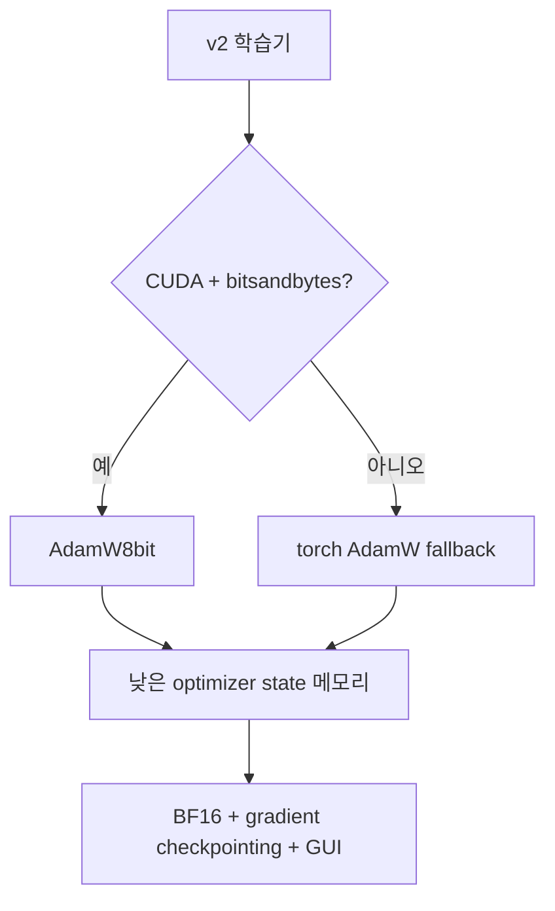

<div align="center">

# 🇰🇷 Korean LLM · v3

### 더 큰 모델을 더 현실적인 메모리로


**v2의 실험 화면을 유지하면서 optimizer 메모리 병목을 겨냥한 버전입니다.**

</div>

## 🧠 무엇이 달라졌나



| 항목 | v2 | v3 |
|---|---|---|
| Optimizer | `torch AdamW` | `bitsandbytes AdamW8bit` 선택 |
| 실패 대응 | 해당 없음 | 미지원 환경에서 일반 AdamW fallback |
| BF16 backward | AMP 흐름 | BF16에서 GradScaler 없이 명확한 backward |
| 모델 구조 | 1920 × 20 × 10 | 동일한 연구 구조 유지 |
| 관찰 도구 | GUI | GUI 유지 |

## 🛠️ 버그·안정성 개선

- bitsandbytes가 없는 환경에서도 학습이 완전히 중단되지 않도록 optimizer fallback 추가
- BF16에서 불필요한 GradScaler 경로를 제거해 precision 흐름을 단순화
- EOS/PAD 검증과 별도 PAD 토큰을 유지해 padding이 EOS로 오인되는 문제를 줄임
- v2의 instruction 정제와 반복 억제 생성 로직을 유지
- 체크포인트에 optimizer/scheduler 상태를 저장해 메모리 최적화 상태에서도 resume 가능

## 🚀 실행

```powershell
pip install torch datasets transformers pandas tqdm matplotlib bitsandbytes
python korean_llm_advanced_v3.py
```

CUDA 또는 bitsandbytes를 사용할 수 없으면 코드가 일반 AdamW로 폴백합니다. 따라서 v3의 핵심은 “특정 GPU에서만 실행”이 아니라 “가능하면 optimizer state를 줄이는 선택적 경로”입니다.

## 📦 구성

- 데이터: `nlpai-lab/kullm-v2`, `beomi/KoAlpaca-v1.1a`
- 모델: RMSNorm · RoPE · SwiGLU · KV-cache · tied embeddings
- 기본 학습: batch 2 · accumulation 32 · learning rate `5e-5` · BF16
- 로그: `logs/` · 체크포인트: `checkpoints/`

## 📌 정확한 기대치

8-bit optimizer는 optimizer state 메모리를 줄이는 기법입니다. 실제 VRAM 절감량과 학습 속도는 GPU, CUDA, PyTorch, bitsandbytes 버전에 따라 달라지므로 이 프로젝트는 특정 VRAM 수치를 보장하지 않습니다.

## 🌿 브랜치 구조

v3는 별도 저장소가 아니라 [Korean-llm 저장소](https://github.com/seoan1024/Korean-llm)의 `v3` 브랜치입니다.

| 브랜치 | 역할 |
|---|---|
| [v1](https://github.com/seoan1024/Korean-llm/tree/V1) | Foundation |
| [v2](https://github.com/seoan1024/Korean-llm/tree/V2) | Observable training |
| **v3** | Memory-efficient training |
| [v4](https://github.com/seoan1024/Korean-llm/tree/V4) | Pretraining + SFT |

## 🔗 링크

- [Korean-llm 저장소](https://github.com/seoan1024/Korean-llm)
- [v3 브랜치](https://github.com/seoan1024/Korean-llm/tree/V3)
- [v4 브랜치](https://github.com/seoan1024/Korean-llm/tree/V4)
- [작성자 seoan1024](https://github.com/seoan1024)
- [LICENSE](./LICENSE)

