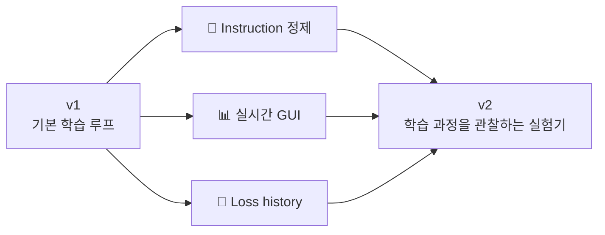

<div align="center">

# 🇰🇷 Korean LLM · v2

### 학습기가 보이기 시작한 순간


**v1의 모델에 데이터 품질과 실시간 관찰 창을 더했습니다.**

</div>

## 🔁 v1 → v2 변화



| 영역 | v1 | v2 |
|---|---|---|
| 데이터 | 텍스트 + 단순 instruction | `instruction/input/output` 정제 |
| 모델 기본 폭 | `dim=1280` | `dim=1920` |
| 학습 길이 | 256 | 256 (RoPE 버퍼 기본 2048) |
| 모니터링 | 로그 중심 | Loss curve + GUI chat |
| 토큰 안전성 | 기본 처리 | EOS/PAD 존재 검증 |

## ✨ 고친 점과 추가된 점

- `instruction`, `input`, `output`을 `### 질문 / ### 입력 / ### 응답` 템플릿으로 일관되게 조립
- 빈 값과 비문자열 필드를 정리해 데이터셋별 포맷 차이로 생기는 오류를 완화
- EOS/PAD ID가 없는 tokenizer를 조용히 진행하지 않고 명시적으로 오류 처리
- v1의 EOS 공유 문제를 줄이기 위해 별도 `<|pad|>` 토큰을 추가
- loss를 `logs/loss_history.json`에 저장해 학습 곡선을 다시 확인 가능
- Tkinter GUI에서 loss, 로그, 체크포인트 상태와 CPU 대화 테스트 제공
- 생성 시 반복 토큰 억제 로직 추가

## 🚀 실행

```powershell
pip install torch datasets transformers pandas tqdm matplotlib
python korean_llm_advanced_v2.py
```

실행 환경에 Tkinter가 포함되어 있어야 합니다. 학습 설정은 `TrainingConfig`에서 변경합니다.

## 🧩 구성

| 구성 | 내용 |
|---|---|
| 데이터 | `nlpai-lab/kullm-v2`, `beomi/KoAlpaca-v1.1a` |
| 모델 | RMSNorm · RoPE · SwiGLU · KV-cache · tied embeddings |
| 로그 | `logs/`, `logs/loss_history.json` |
| 체크포인트 | `checkpoints/korean_llm_*.pth` |
| Optimizer | 일반 `torch.optim.AdamW` |

## ⚠️ 남아 있는 한계

v2는 아직 validation split이 없고, 8-bit optimizer도 도입되지 않았습니다. GUI는 로컬 데스크톱 실행을 전제로 합니다. 이 두 문제는 각각 v3와 v4에서 발전합니다.

## 🌿 브랜치 구조

v1·v2·v3·v4는 서로 다른 저장소가 아닙니다. 모두 하나의 [Korean-llm 저장소](https://github.com/seoan1024/Korean-llm) 안에서 브랜치로 관리됩니다.

| 브랜치 | 내용 |
|---|---|
| [v1](https://github.com/seoan1024/Korean-llm/tree/V1) | 기본 학습 루프 |
| **v2** | Instruction 정제와 GUI |
| [v3](https://github.com/seoan1024/Korean-llm/tree/V3) | 8-bit optimizer |
| [v4](https://github.com/seoan1024/Korean-llm/tree/V4) | Pretraining/SFT 파이프라인 |

## 🔗 링크

- [Korean-llm 저장소](https://github.com/seoan1024/Korean-llm)
- [v2 브랜치](https://github.com/seoan1024/Korean-llm/tree/V2)
- [작성자 seoan1024](https://github.com/seoan1024)
- [LICENSE](./LICENSE)

