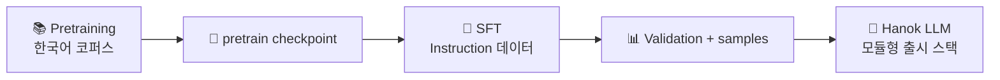
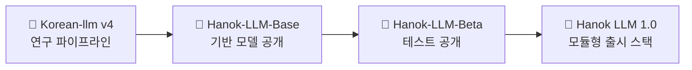

<div align="center">

# 🏯 Korean LLM · v4

### 연구용 Korean-llm에서 출시형 Hanok LLM으로


**v1~v3의 실험을 하나의 명시적인 학습 파이프라인으로 정리한 마지막 연구 단계**

<br/>

[🏯 Hanok LLM 출시 저장소](https://github.com/seoan1024/Hanok-LLM) · [🤗 Hanok LLM 모델](https://huggingface.co/seoan1024/Hanok-LLM) · [🔬 Korean-llm 연구 저장소](https://github.com/seoan1024/Korean-llm)

</div>

## 🌉 v4의 핵심 변화



| 영역 | v3 | v4 |
|---|---|---|
| 학습 단계 | 단일 단계 | `pretrain → SFT` 또는 수동 선택 |
| 데이터 | 고정된 기본 목록 | CLI로 dataset/config 지정 |
| 대용량 처리 | 전체 materialize 가능 | 제한 샘플 streaming cache |
| 평가 | 생성 샘플 중심 | validation split + validation loss |
| 학습 대상 | 전체 토큰 | SFT에서 response-only labels |
| 실행 | 파일 설정 수정 | `argparse` CLI |
| 체크포인트 | 단일 디렉터리 | `pretrain/`, `sft/` 분리 |

## 🛠️ 고친 버그와 안정성 개선

- streaming iterator를 무제한 `list()`로 materialize하지 않고 `max_examples`로 제한
- pretraining에서 SFT 데이터를 실수로 사용하는 경로를 막고 데이터셋 명시를 요구
- EOS와 PAD를 분리해 padding을 실제 학습 목표에서 제외
- SFT prompt 부분은 `-100`, response만 label로 만들어 instruction leakage를 줄임
- 모든 label이 `-100`인 빈 target batch도 loss 계산이 깨지지 않도록 안전 처리
- train/validation을 seed 기반으로 분리하고 validation loss를 주기적으로 기록
- pretraining checkpoint에서 SFT로 넘어갈 때 optimizer/scheduler를 새로 시작하는 model-only resume 지원
- `--no-gui`로 서버·자동 실행을 지원하고, `--dataset` 반복 지정으로 데이터 구성을 외부화

## 🚀 실행

```powershell
pip install torch datasets transformers pandas tqdm matplotlib pyarrow bitsandbytes
python korean_llm_advanced_v4.py --stage auto --dataset AdaMLLab/KorMix --samples-per-dataset 10000 --no-gui
```

수동 실행:

```powershell
python korean_llm_advanced_v4.py --stage pretrain --dataset AdaMLLab/KorMix --stream-datasets --samples-per-dataset 10000 --no-gui
python korean_llm_advanced_v4.py --stage sft --resume-from-checkpoint checkpoints/pretrain/korean_llm_100000.pth --no-gui
```

데이터셋의 config와 라이선스는 반드시 [Hugging Face 원본](https://huggingface.co/datasets/AdaMLLab/KorMix)에서 확인하세요.

## 🧱 모델·산출물

| 항목 | v4 |
|---|---|
| 구조 | RMSNorm · RoPE · SwiGLU · KV-cache · tied embeddings |
| 기본 모델 | `dim=1920` · `20 layers` · `10 heads` |
| 학습 | BF16 · 선택적 8-bit AdamW · cosine warmup |
| 기본 단계 | pretraining 100k · SFT 10k steps |
| 검증 | validation split 2% · 최대 32 batches |
| 출력 | `checkpoints/pretrain/`, `checkpoints/sft/`, `logs/` |

## 🏯 Hanok LLM 출시 여정

v4에서 정리한 연구 결과는 한 번에 끝난 것이 아니라 **Base 모델 → Beta 테스트 공개 → Hanok LLM 출시** 순서로 이어졌습니다.



| 단계 | 의미 | 링크 |
|---|---|---|
| 🧱 Base | Hanok 계열의 기반 모델 | [Hanok-LLM-Base](https://huggingface.co/seoan1024/Hanok-LLM-Base) |
| 🧪 Beta | 실제 사용과 피드백을 위한 테스트 공개 모델 | [Hanok-LLM-Beta](https://huggingface.co/seoan1024/Hanok-LLM-Beta) |
| 🏯 Hanok LLM | 데이터·학습·추론·평가·export·모니터링을 분리한 출시형 스택 | [GitHub 저장소](https://github.com/seoan1024/Hanok-LLM) · [모델 페이지](https://huggingface.co/seoan1024/Hanok-LLM) |

추가 문서: [Hanok 한국어 README](https://huggingface.co/seoan1024/Hanok-LLM/blob/main/README.ko.md)

> Korean-llm이 “직접 만들고 검증하는 연구실”이라면, Base는 기반 모델, Beta는 테스트 공개, Hanok LLM은 그 결과를 재사용 가능한 구조와 배포 흐름으로 옮긴 출시 단계입니다.

## ⚠️ 정확한 범위

v4 코드는 약 1B급 구조를 정의하지만 실제 파라미터 수는 tokenizer vocabulary와 설정에 따라 달라집니다. Hanok의 출시 저장소에도 학습 가중치·벤치마크 포함 여부가 별도로 표시되므로, 사용 전 해당 모델 카드와 라이선스를 확인하세요.

## 🔗 버전 여정

모든 연구 버전은 하나의 저장소에서 브랜치로 관리됩니다.

[v1 브랜치](https://github.com/seoan1024/Korean-llm/tree/V1) → [v2 브랜치](https://github.com/seoan1024/Korean-llm/tree/V2) → [v3 브랜치](https://github.com/seoan1024/Korean-llm/tree/V3) → **[v4 브랜치](https://github.com/seoan1024/Korean-llm/tree/V4)** → [🧱 Base](https://huggingface.co/seoan1024/Hanok-LLM-Base) → [🧪 Beta](https://huggingface.co/seoan1024/Hanok-LLM-Beta) → [🏯 Hanok LLM](https://github.com/seoan1024/Hanok-LLM)

## 👤 작성자

[seoan1024](https://github.com/seoan1024) · 한국어 LLM을 직접 구현하고 연구용 코드에서 배포 가능한 스택으로 확장하는 개발자.

## 📄 라이선스

[LICENSE](./LICENSE)

